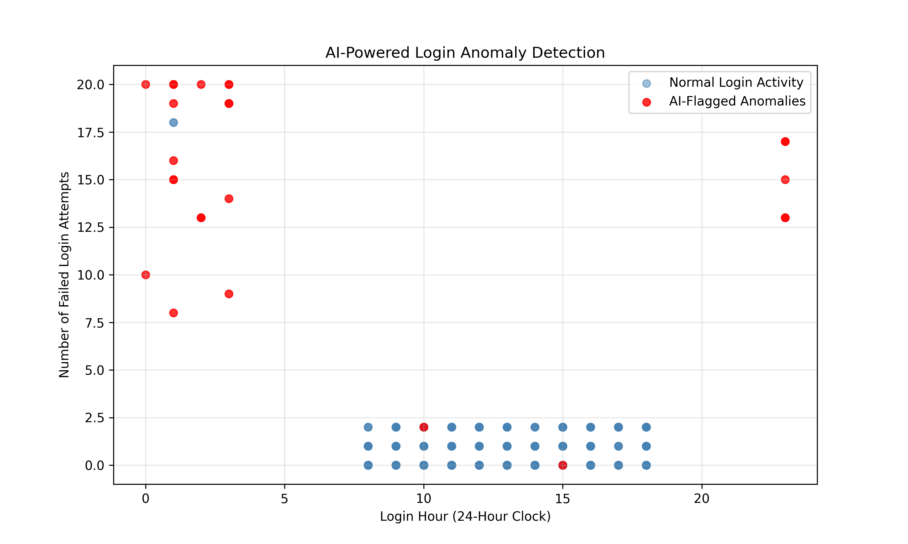

# AI-Powered Login Anomaly Detector

A beginner-friendly cybersecurity machine learning project using Python and Isolation Forest to flag unusual login events for analyst review.

## Features
- Generates 500 synthetic login events, including intentionally unusual patterns.
- Uses login hour, failed attempts, new IP indicator, and country mismatch indicator as model features.
- Trains an unsupervised Isolation Forest model and exports flagged events to CSV.
- Uses only synthetic data, with no real credentials or personal information.

## Setup
Requires Python 3.10+.

```bash
python -m venv .venv
```

Activate the environment:
- Windows PowerShell: `.venv\Scripts\Activate.ps1`
- macOS/Linux: `source .venv/bin/activate`

Install dependencies:
```bash
python -m pip install -r requirements.txt
```

## Run
```bash
python generate_logs.py
python detect_anomalies.py
```

Review `reports/flagged_logins.csv` for results.

## How it works
Isolation Forest is an unsupervised anomaly detection algorithm. It assigns lower decision-function scores to unusual records; a prediction of `-1` indicates a flagged event. The contamination setting of 0.05 is an assumed proportion of outliers, not a validated real-world attack rate.

## Limitations
- The dataset is synthetic and intentionally simplified.
- Flagged events are anomalies, **not confirmed malicious logins**.
- Training and scoring use the same dataset; there is no independent validation set or measured detection accuracy.
- Real security monitoring requires time-aware baselines, data governance, alert triage, and evaluation against labeled incidents.

## Potential improvements
- Add evaluation on a separate labeled test set.
- Compare against rule-based detection.
- Visualize anomaly scores and event distributions.

## AI Detection Results

The Isolation Forest model analyzed 500 synthetic login events and flagged 25 events (5%) as anomalies for further investigation.

The model evaluates four features:
- Login hour
- Number of failed login attempts
- New IP address indicator
- Country mismatch indicator

### Anomaly Visualization



Blue points represent events not flagged by the model, while red points represent anomalies.

The visualization shows that many flagged events occurred outside typical business hours or involved unusually high numbers of failed login attempts.

Some anomalies may appear normal in this graph because the model also evaluates IP and country indicators.

**Note:** The dataset is synthetic, and flagged events are not necessarily confirmed attacks. The 5% anomaly rate reflects the model's configured contamination setting, not its detection accuracy.
